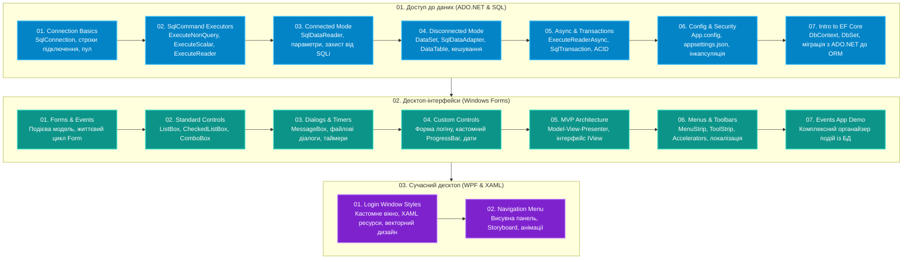

# IT Step Academy: C# Desktop & Databases Mastery

[](https://dotnet.microsoft.com/)
[](https://docs.microsoft.com/en-us/dotnet/csharp/)
[](https://docs.microsoft.com/en-us/dotnet/framework/data/adonet/)
[](https://docs.microsoft.com/en-us/dotnet/desktop/)
[](https://github.com/)

Комплексний практичний навчально-інженерний репозиторій курсів **IT Step Academy**, присвячений роботі з реляційними базами даних (**ADO.NET, MS SQL Server, Entity Framework**), розробці десктопних застосунків на **Windows Forms** (із застосуванням архітектурного патерну **MVP**) та сучасних клієнтських інтерфейсів на **WPF** (векторна графіка, XAML-стилі, анімації).

---

## 🗺️ Дорожня карта курсу (Roadmap)



---

## 📚 Повний каталог модулів курсу

### Частина 1: Бази даних та ADO.NET (`01-Databases-AdoNet`)

| Модуль | Тематика | Ключові технології | Гілка |
|:---|:---|:---|:---:|
| **[01-Connection-Basics](01-Databases-AdoNet/01-Connection-Basics/)** | Підключення до БД | `SqlConnection`, `ConnectionString`, пул з'єднань, обробка `SqlException` | `feat/01-adonet-connection-basics` |
| **[02-SqlCommand-Executors](01-Databases-AdoNet/02-SqlCommand-Executors/)** | Виконання SQL-команд | `SqlCommand`, `ExecuteNonQuery`, `ExecuteScalar`, `ExecuteReader`, `FillOrCancelForm` | `feat/02-adonet-sqlcommand-executors` |
| **[03-Connected-Mode-Reader](01-Databases-AdoNet/03-Connected-Mode-Reader/)** | Зв'язний режим | Швидкий курсор `SqlDataReader`, параметризовані запити, захист від SQL Injection | `feat/03-adonet-connected-mode-reader` |
| **[04-Disconnected-Mode-DataSet](01-Databases-AdoNet/04-Disconnected-Mode-DataSet/)** | Незв'язний режим | `DataSet`, `DataTable`, `SqlDataAdapter`, `SqlCommandBuilder`, офлайн-робота з даними | `feat/04-adonet-disconnected-mode-dataset` |
| **[05-Async-And-Transactions](01-Databases-AdoNet/05-Async-And-Transactions/)** | Асинхронність та Транзакції | `async/await`, `ExecuteReaderAsync`, `SqlTransaction`, `Commit/Rollback`, збережені процедури | `feat/05-adonet-async-transactions` |
| **[06-Configuration-And-Security](01-Databases-AdoNet/06-Configuration-And-Security/)** | Конфігурація та Безпека | `App.config`, `appsettings.json`, `ConfigurationManager`, Dependency Injection, Dapper | `feat/06-adonet-config-security` |
| **[07-Intro-To-EntityFramework](01-Databases-AdoNet/07-Intro-To-EntityFramework/)** | Вступ до Entity Framework | Перехід до ORM, `DbContext`, `DbSet<T>`, ChangeTracker, Database/Code First | `feat/07-adonet-intro-entityframework` |

---

### Частина 2: Десктоп-розробка на Windows Forms (`02-Desktop-WinForms`)

| Модуль | Тематика | Ключові технології | Гілка |
|:---|:---|:---|:---:|
| **[01-Forms-And-Events](02-Desktop-WinForms/01-Forms-And-Events/)** | Форми та Події | Цикл життя вікна (`Load`, `Closing`), події миші, клавіатури, обробники подій | `feat/08-winforms-forms-events` |
| **[02-Standard-Controls](02-Desktop-WinForms/02-Standard-Controls/)** | Спискові компоненти | `ListBox`, `CheckedListBox`, `ComboBox`, `ProgressBar`, `SelectedIndexChanged` | `feat/09-winforms-standard-controls` |
| **[03-Dialogs-And-Timers](02-Desktop-WinForms/03-Dialogs-And-Timers/)** | Діалоги та Таймери | `MessageBox`, `OpenFileDialog`, `SaveFileDialog`, `ColorDialog`, `Timer` | `feat/10-winforms-dialogs-timers` |
| **[04-Custom-Controls-Login](02-Desktop-WinForms/04-Custom-Controls-Login/)** | Авторизація та UI | Форма логіну, кастомний `ProgressBar`, `DateTimePicker`, масштабування вікна | `feat/11-winforms-custom-controls-login` |
| **[05-MVP-Architecture](02-Desktop-WinForms/05-MVP-Architecture/)** | Архітектура MVP | Патерн **Model-View-Presenter**, інтерфейс `IView`, тестування UI, слабке зв'язування | `feat/12-winforms-mvp-architecture` |
| **[06-Menus-Toolbars-I18n](02-Desktop-WinForms/06-Menus-Toolbars-I18n/)** | Меню та Локалізація | `MenuStrip`, `ToolStrip`, `StatusStrip`, Accelerators (гарячі клавіші), багатомовність | `feat/13-winforms-menus-toolbars-i18n` |
| **[07-Events-App-Demo](02-Desktop-WinForms/07-Events-App-Demo/)** | Комплексний демо-застосунок | Застосунок органайзера подій (MyEvents) із підключенням до MS SQL Server (ADO.NET + EF) | `feat/14-winforms-events-app-demo` |

---

### Частина 3: Сучасний інтерфейс на WPF (`03-Desktop-WPF`)

| Модуль | Тематика | Ключові технології | Гілка |
|:---|:---|:---|:---:|
| **[01-Login-Window-Styles](03-Desktop-WPF/01-Login-Window-Styles/)** | Кастомний XAML UI | Вікно без рамки (`WindowStyle.None`), `DragMove()`, векторні ресурси, стилі кнопок | `feat/15-wpf-login-window-styles` |
| **[02-Navigation-Menu-Animations](03-Desktop-WPF/02-Navigation-Menu-Animations/)** | Анімована навігація | Бічна панель, `Storyboard`, `DoubleAnimation`, плавні переходи, векторні іконки | `feat/16-wpf-navigation-menu-animations` |

---

## 🛠️ Вимоги та запуск

- **SDK:** .NET 8.0 або новіший (із підтримкою Windows Desktop SDK).
- **ОС:** Windows 10/11.
- **СУБД:** Microsoft SQL Server (LocalDB / Express / Developer) для модулів ADO.NET.
- **IDE:** Visual Studio 2022/2026 або JetBrains Rider.

```bash
git clone https://github.com/MrTomkaYurii/ITStep-Desktop-And-Databases-Mastery.git
cd ITStep-Desktop-And-Databases-Mastery
```
